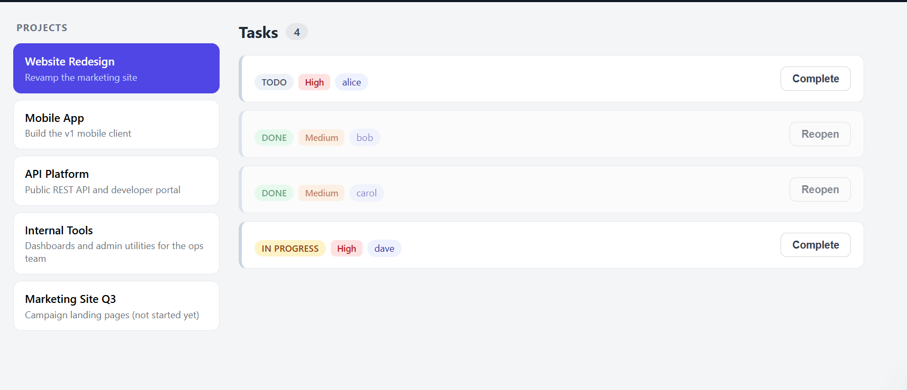
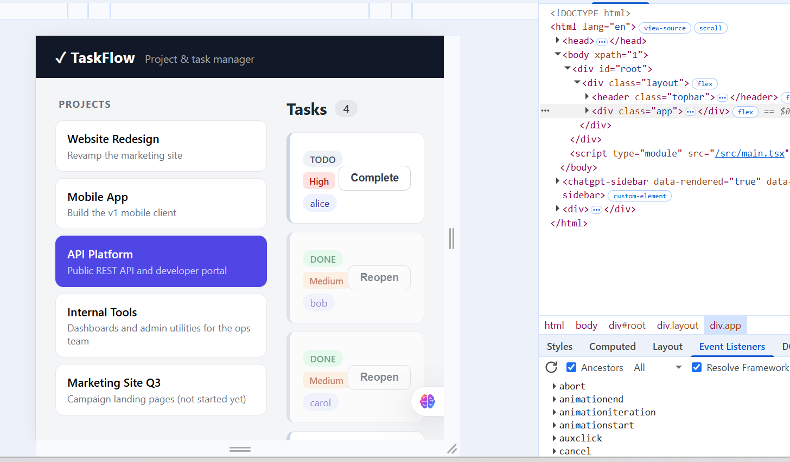

BUG REPORT
Findings 1:

Title: The status button is not clickable

Severity: High, Users are not able to click complete or ReOpen a task.

Steps to Reproduce:
1. Navigate to Taskflow URL
2. Select a project
3. Click on Complete/ReOpen button

Expected: Users should be able to click on the status button to reopen or complete a task
Actual:  Users are not able to click the status button

Evidence: 

Who is hurt: End Users

Finding 2:

Title: The application's UI is not consistent on smaller screens

Severity: Medium, Users can perform other actions but the experience with the interface is not consisitent.

Steps To Reproduce: 
1. Navigate to Taskflow URL
2. Minimize the screen by opening the developer's tab
3. Observe the User Interface

Expected: The UI should either be consistent on smallers screens or be redirected to empty interface with an information (eg. Application is not accessible on smaller screens)

Actual: The UI is not consistent on smaller screen.

Evidence: 

Who is hurt: End Users.

Findings 3:

Title: Url routing throws generic error message instead redirecting to UI Page Not Found Page.

Severity: medium, non technical users will not be able to understand the error

API TEST FINDINGS:
1. Backend returns 401 unauthorised for new user registration, due to this, users are unable to register their account. -
2. The GET api/projects endpoint return HTML response intead of JSON

TEST PLAN 
Project Name: Taskflow
Prepared By: Francis Roland Bissah

Introduction: This is a  document that defines the approach to the testing acticities.

Objectives: The purpose of this is to test the core functionalities of Taskflow.

Scope Of Testing:
In-scope: Functional Testing, Non-functional testing and Api Testing
Out-of-scope: External integration testing

Testing Design
 Error guessing

 Testing Environment:
 OS: Windows
 Browser: Google chrome
 Environment: Testing environment

 Entry criteria:
 Application url should be available
 Testing emvironment should be ready
 Test cases should be prepared

 Exit criteria:
 All critical bugs are fixed

 Appprovals
 Signed by QA Lead, PO and Stakeholders
